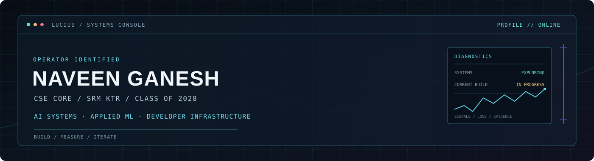

<div align="center">
  
</div>

**AI SYSTEMS · APPLIED ML · DEVELOPER INFRASTRUCTURE**

*Reality is an undocumented API. I'm reverse-engineering it.*

[GitHub](https://github.com/Lucius-cloud) · [LinkedIn](https://www.linkedin.com/in/naveen-ganesh/)

</div>

---

## `01 / OPERATOR`

I'm **Naveen Ganesh**, a third-year Computer Science and Engineering student at **SRM KTR** (`Class of 2028`).

I like understanding what happens beneath the interface: how models behave, how software systems fail, and how useful tools turn noisy signals into clear decisions.

My current direction sits at the intersection of **AI systems, applied machine learning, and developer tooling**. I care about building things that work, measuring what they actually do, and documenting the trade-offs.

## `02 / CURRENT BUILD`

### Commitopsy — incident timelines from deployment evidence

`STATUS: IN PROGRESS`

Deployments and application-health regressions do not always line up neatly. Commitopsy is being developed to correlate deployment events with application-health signals and help construct evidence-backed incident timelines.

**The engineering question:** can incident investigation become less dependent on guesswork by bringing relevant evidence into one timeline?

- **Focus:** deployment-event correlation, application-health signals, incident investigation.
- **Status:** active development; capabilities should be judged by the implementation currently in the repository.
- **Next proof point:** a reproducible end-to-end demo with documented inputs, outputs, and limitations.

[Explore the repository →](https://github.com/Lucius-cloud/commitopsy)

## `03 / SELECTED ENGINEERING`

### ORION — Visual Intelligence

On-device computer vision for Android, combining object detection with a mobile camera pipeline.

- **Stack:** Kotlin · CameraX · YOLOv8 · TensorFlow Lite
- **Reported prototype measurements:** approximately `68% mAP@50`, `58% mAP@50–95`, and `150–220 ms` inference latency on the tested OnePlus Nord CE4 Lite.
- **Engineering focus:** model training and evaluation, mobile inference, and integrating ML into an on-device application.

These are project-reported prototype results, not a claim of production-grade accuracy or performance.

[Explore the repository →](https://github.com/Lucius-cloud/ORION-Visual-Intelligence)

## `04 / TECHNICAL TERRAIN`

| Area | What I'm exploring |
|---|---|
| **AI systems** | Model behaviour, evaluation, inference, and system-level trade-offs |
| **Applied ML** | Computer vision and practical ML pipelines |
| **Agentic AI** | Tool use, RAG, and workflows that can be inspected and evaluated |
| **Developer infrastructure** | Observability, deployment signals, debugging, and incident analysis |
| **Software engineering** | APIs, data flow, testing, reliability, and maintainable architecture |

This is a map of my interests—not a claim that every area is already a research speciality.

## `05 / ENGINEERING DOCTRINE`

```text
01  First principles before assumptions.
02  Evidence before conclusions.
03  Measure before optimizing.
04  Design for failure, not only the happy path.
05  If it cannot be reproduced, document what is missing.
```

<details>
<summary><code>CONTINGENCY_PROTOCOL.md</code> — open if the system behaves unexpectedly</summary>

1. Check the logs.
2. Reproduce the failure.
3. Challenge the assumption.
4. Roll back if needed.
5. If all else fails, check whether the GPU bill has become sentient.

</details>

---

<div align="center">

`BUILD / MEASURE / ITERATE`

<sub>Designed to be a workbench, not a trophy cabinet.</sub>

</div>
