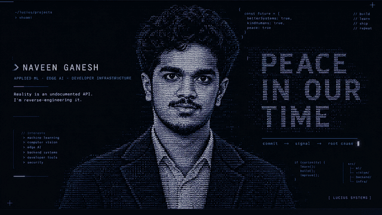

  

---

  APPLIED ML · EDGE AI · DEVELOPER INFRASTRUCTURE
    
  <em>Reality is an undocumented API. I'm reverse-engineering it.</em>

---

## `01 / CURRENT BUILD`

### [Commitopsy ↗](https://github.com/Lucius-cloud/commitopsy)

STATUS: IN PROGRESS

Find what changed before a deployment broke. Commitopsy correlates GitHub Actions events with application-health regressions to help assemble evidence-backed incident timelines.

`Focus:` deployment signals · health regressions · incident investigation

---

## `02 / SELECTED ENGINEERING`

### [ORION — Visual Intelligence ↗](https://github.com/Lucius-cloud/ORION-Visual-Intelligence)

Privacy-first electronic-component detection running on an Android device, using a live CameraX pipeline and a YOLOv8 model exported to TensorFlow Lite.

`Kotlin` · `CameraX` · `YOLOv8` · `PyTorch` · `TensorFlow Lite` · `OpenCV`

Reported prototype results: approximately 68% mAP@50 and 150–220 ms inference latency on a OnePlus Nord CE4 Lite. These are prototype measurements, not production guarantees.

### [CipherSafe ↗](https://github.com/Lucius-cloud/ciphersafe)

A credential-manager API built around JWT sessions, AES-encrypted credential storage, TOTP two-factor authentication, and Have I Been Pwned breach checks.

`Node.js` · `Express` · `MongoDB` · `JWT` · `AES` · `TOTP`

---

## `03 / TOOLKIT`

  
    
  Computer Science & Engineering · SRM KTR · Class of 2028

---

## `04 / WHAT I OPTIMIZE FOR`

- Evidence before assumptions.
- Measurement before optimization.
- Systems that behave sensibly outside the happy path.
- AI that can be evaluated, deployed, and understood.

   
  <code>BUILD / MEASURE / ITERATE</code>
    
  The Bat-Signal is just another failing health check.

